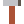
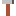

# md


**A Markdown viewer/editor for Windows built for the fastest possible cold start.**

* C11, compiled with MSVC only, built with CMake
* SDL3 + SDL3_ttf (FreeType, HarfBuzz, plutosvg) + SDL3_image for rendering
* tree-sitter + tree-sitter-markdown for parsing
* Roboto (Regular, Italic, Medium, Bold, Bold Italic, Light, Mono, Mono Italic)
  and Noto Color Emoji embedded in the executable
* Ships as a single `md.exe`: every dependency and the C runtime are linked
  statically, fonts are Win32 resources read in place from the mapped image

##  Building

Requires **CMake 4.0 or newer** and **Visual Studio 2026** (workload
"Desktop development with C++"). All dependencies are downloaded by CMake
`FetchContent` during configure, so the first configure takes a while.

Everything is driven by `CMakePresets.json`. The quickest way is the default
workflow, which configures with the `Visual Studio 18 2026` generator (x64)
and builds Release:

```bat
cmake --workflow --preset default
build\vs2026\Release\md.exe README.md
```

Or step by step:

```bat
cmake --preset vs2026
cmake --build --preset release      :: or: --preset debug
```

`build\vs2026\md.sln` can also be opened in Visual Studio, or open the folder
directly and pick a preset there.

For Ninja builds, run from a *Developer Command Prompt for VS 2026*:

```bat
cmake --preset ninja-release
cmake --build --preset ninja-release
build\ninja-release\md.exe README.md
```

| Configure preset | Generator | Output |
| --- | --- | --- |
| `vs2026` (default) | Visual Studio 18 2026, x64 | `build/vs2026/<Config>/md.exe` |
| `ninja-release` | Ninja, MSVC `cl` | `build/ninja-release/md.exe` |
| `ninja-debug` | Ninja, MSVC `cl` | `build/ninja-debug/md.exe` |

##  Usage

```
md.exe file.md          # viewer only
md.exe -e file.md       # editor open from the start (also --edit)
```

md opens as a **viewer**: just the rendered Markdown. Press Ctrl+Shift+S (or
start md with `-e`) to start Neovim and bring it in beside the preview. Neovim is only launched when
you first ask for the editor, so a plain view never runs it. The preview
follows the buffer as you type, and scrolling stays in sync both ways: scroll
the editor and the preview follows, scroll the preview and the editor follows.
Select text in the preview with the mouse (or Ctrl+A) and press Ctrl+C to copy
it. Without `nvim` on `PATH`, md stays a viewer and says why when you ask for
the editor.

See [docs/features.md](docs/features.md) for a tour of everything md renders;
open it in md to try it out.

| Key | Action |
| --- | --- |
| F1 | Show / hide a list of all shortcuts |
| Ctrl+Shift+O | Switch split orientation (side by side / stacked) |
| Ctrl+Shift+S | Split on/off (off = preview only, the default) |
| Ctrl+Shift+X | Swap sides: editor left/right (top/bottom when stacked) |
| Ctrl+Shift+E | Editor only on/off |
| Ctrl+Shift+Tab | Move keyboard focus between editor and preview |
| Ctrl+Shift+N | Open a file (also: drop a file on the window) |
| Ctrl+O / Ctrl+Q | Open / quit, when the preview has focus |
| Ctrl+A / Ctrl+C | Select all / copy the selection, when the preview has focus |
| Click a link | Open it (drag over a link to select its text instead) |
| PgUp / PgDn / Space / Home / End, wheel | Scroll the preview (the editor follows) |
| j / k, Ctrl+d / Ctrl+u, Ctrl+f / Ctrl+b, gg / G | Vim-style scrolling in the preview; counts work (5j, 42G = source line 42) |
| / or ?, then n / N | Search the preview forward / backward, then jump between matches (case-insensitive unless the text has a capital) |

App shortcuts use Ctrl+Shift so they never clash with AltGr letters on Polish
and other keyboards (AltGr is Ctrl+Alt on Windows) or with Neovim's own keys.
Everything else goes to Neovim. Closing the window sends `:qa` to Neovim, so
unsaved changes are never dropped silently.

###  Rendering

* Headings, paragraphs, hard/soft line breaks, block quotes (nested), lists
  (nested, ordered, task lists), horizontal rules
* Bold, italic, strikethrough, inline code, escapes, HTML entities
* Links (inline, reference, autolinks, e-mail); click to open, `.md` links
  open in md
* Tables with column alignment and inline formatting in cells
* Images (PNG, JPG, GIF, BMP, SVG, QOI, ...) loaded in the background,
  relative to the document; remote images show their alt text
* Emoji including ZWJ sequences, skin tones, flags and keycaps
  (Noto Color Emoji)
* Fenced code with syntax highlighting (tree-sitter) for C, C++, C#, Python,
  JavaScript, JSON, Bash, Rust and Lua
* Light/dark theme following Windows

##  Neovim config

`nvim/init.lua` is the editor config for the embedded Neovim pane (Neovim
0.12+). It sets a few prose-friendly options and installs the
[catppuccin](https://github.com/catppuccin/nvim) colorscheme through the
built-in `vim.pack`, using the Mocha flavour with brighter line numbers.

The file is compiled into `md.exe`. On startup md writes it to
`%APPDATA%\md\init.lua` (only when it changed) and starts, in the background,

```
nvim --embed -u %APPDATA%\md\init.lua [file.md]
```

`nvim` must be on `PATH`. To try the config on its own:

```bat
nvim -u nvim\init.lua README.md
```

##  Pixel art assets (PICO-8 palette)

md's pixel art is drawn as text in `art/*.txt` and turned into PNGs by
`pixelart.exe` (`tools/pixelart`), a small console tool. Every pixel is one
character: `0`-`9`, `a`-`f` pick one of the 16
[PICO-8 colours](https://pico-8.fandom.com/wiki/Palette), `.` is transparent.

```
sprite ok x1 x2 x4
........
.......b
......bb
b....bb.
bb..bb..
.bbbb...
..bb....
........
```

`x1 x2 x4` are the sizes to write: `ok.png`, `ok@2x.png`, `ok@4x.png`, scaled
by repeating pixels so edges stay sharp. Adding `ico` to the header also
writes `<name>.ico` with every size up to 256x256. A blank line ends a sprite.

| Sheet | Sprites |
| --- | --- |
| `art/sprites.txt` |  app icon,    status icons |
| `art/readme.txt` |        this README's section icons and the palette strip |

`md.exe`'s own icon (Explorer, taskbar, title bar) is `art/png/md-icon.ico`,
compiled into the executable as an `ICON` resource.

The generated files are committed in `art/png`; after editing a sheet,
regenerate them with

```bat
cmake --build --preset release --target art
```

or run the tool directly: `pixelart.exe -o art\png art\sprites.txt`.
Mistakes (unknown colour characters, ragged rows, bad scales) are reported as
`file:line: error: ...` and the tool exits with status 1.
`-DMD_BUILD_TOOLS=OFF` leaves the tool out of the build.

##  How startup is kept fast

1. Before `SDL_Init`, three threads start: one initialises FreeType/HarfBuzz
   and opens the embedded fonts, one reads and parses the file, one writes the
   Neovim config and spawns `nvim --embed`.
2. The main thread creates the window and renderer, presents one frame in the
   background colour and only then shows the window, so there is no flash.
3. The main thread waits for the fonts only when it is about to draw text.
4. Fonts are never copied: FreeType reads them straight from the executable's
   resource section, and only the pages it touches get loaded.
5. Only the visible part of the document is laid out before the first frame;
   the rest is laid out in small slices while the app is idle. Text objects
   are created the first time a line is drawn.
6. Images and syntax highlighting queries load lazily on worker threads.
7. The window is DPI-aware through the manifest, so it opens at the right size.

##  Source layout

| File | Purpose |
| --- | --- |
| `src/main.c` | Startup, event loop, split layout, input routing |
| `src/document.c` | tree-sitter block + inline parsing into blocks and styled spans |
| `src/view.c` | Rich-text layout engine and preview drawing |
| `src/highlight.c`, `src/regex.c` | Code block highlighting with tree-sitter queries |
| `src/nvim.c`, `src/msgpack.c` | Neovim process and msgpack-RPC UI client |
| `src/editor.c` | Draws Neovim's grid |
| `src/fonts.c`, `src/assets.c` | Embedded fonts (RCDATA) and font cache |
| `src/emoji.c`, `src/images.c` | Emoji clustering, async image loading |
| `tools/pixelart/pixelart.c`, `art/` | PICO-8 sprite sheets to PNG assets |

##  Status

All four planned steps are in: skeleton and fast start, full viewer, embedded
Neovim with split view, and code highlighting / scroll sync / startup polish.


