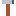

# md


**A Markdown viewer/editor for Windows built for the fastest possible cold start.**

* C11, compiled with MSVC only, built with CMake
* SDL3 + SDL3_ttf (FreeType, HarfBuzz, plutosvg) + SDL3_image for rendering
* tree-sitter + tree-sitter-markdown for parsing
* Roboto (Regular, Italic, Medium, Bold, Bold Italic, Light), Roboto Serif
  (Regular, Italic, Medium, Bold, Bold Italic; optional body font), Roboto Mono
  Nerd Font (Regular, Italic, Bold, Bold Italic; editor and code), Noto Color
  Emoji and Noto Sans Math / Symbols 2 (arrows, math, check marks) embedded in
  the executable
* Ships as a single `md.exe`: every dependency and the C runtime are linked
  statically, fonts are Win32 resources read in place from the mapped image

##  Building

Requires **CMake 4.0 or newer** and **Visual Studio 2026** (workload
"Desktop development with C++"). All dependencies are downloaded by CMake
`FetchContent` during configure, so the first configure takes a while.

Everything is driven by `CMakePresets.json`. The quickest way is the default
workflow, which configures with the `Visual Studio 18 2026` generator (x64)
and builds Release:

```bat
cmake --workflow --preset default
build\vs2026\Release\md.exe README.md
```

Or step by step:

```bat
cmake --preset vs2026
cmake --build --preset release      :: or: --preset debug
```

`build\vs2026\md.sln` can also be opened in Visual Studio, or open the folder
directly and pick a preset there.

For Ninja builds, run from a *Developer Command Prompt for VS 2026*:

```bat
cmake --preset ninja-release
cmake --build --preset ninja-release
build\ninja-release\md.exe README.md
```

| Configure preset | Generator | Output |
| --- | --- | --- |
| `vs2026` (default) | Visual Studio 18 2026, x64 | `build/vs2026/<Config>/md.exe` |
| `ninja-release` | Ninja, MSVC `cl` | `build/ninja-release/md.exe` |
| `ninja-debug` | Ninja, MSVC `cl` | `build/ninja-debug/md.exe` |

The output folder holds md.exe only. Everything else the build produces
(dependency libraries, PDBs, pixelart.exe) goes to `artifacts/` next to it,
e.g. `build/vs2026/artifacts/Release`.

### Installing

md.exe is self-contained, so installing copies that one file, as both
`md.exe` and `mdv.exe` (the same program under a second name). The default
location is a folder meant to be on `PATH`, the first of:

1. the `PATH_APPS` environment variable, if set;
2. `%USERPROFILE%\Documents\PathApps`, if that folder exists;
3. `%USERPROFILE%\PathApps`.

Put that folder on `PATH` once and every app installed there runs from
anywhere. The default is picked when configuring, so re-run
`cmake --preset vs2026` after changing `PATH_APPS`.

```bat
cmake --preset vs2026
cmake --build --preset install
:: or another location:
cmake --install build\vs2026 --config Release --prefix C:\Tools\md
```

Changing `CMAKE_INSTALL_PREFIX` when configuring also changes the default.

##  Usage

```
md.exe file.md          # viewer only
md.exe -e file.md       # editor open from the start (also --edit)
md.exe --dark file.md   # force the dark theme (--light, -d, -l, --theme=system)
md.exe --serif file.md  # text in Roboto Serif (--sans, --font=serif|sans)
md.exe --help           # every option and shortcut (also -h, /?)
md.exe --version        # version from CMakeLists.txt project() (also -V)
```

md.exe is a Windows GUI program, so `--help` and `--version` print to the
console md was started from (or to a file / pipe when redirected:
`md --help | more`), and show a message box when there is no console. The
version is also in the exe's file properties.

md opens as a **viewer**: just the rendered Markdown. Press Ctrl+Shift+S (or
start md with `-e`) to start Neovim and bring it in beside the preview. Neovim is only launched when
you first ask for the editor, so a plain view never runs it. The preview
follows the buffer as you type, and scrolling stays in sync both ways: scroll
the editor and the preview follows, scroll the preview and the editor follows.
Select text in the preview with the mouse (or Ctrl+A) and press Ctrl+C to copy
it as rich text (Ctrl+Shift+C for plain text). Code blocks get a copy button in
their top-right corner when the mouse is over them, and the preview shows an
Aa button in its top-right corner that switches the text between Roboto and
Roboto Serif (same as F7). Without `nvim` on `PATH`, md stays a viewer and says why when you ask for
the editor.

See [docs/features.md](docs/features.md) for a tour of everything md renders;
open it in md to try it out.

| Key | Action |
| --- | --- |
| F1 | Show / hide a list of all shortcuts |
| F2 | Copy the full path of the open file |
| F5 | Reload the file from disk (through Neovim when it runs; unsaved edits are kept) |
| F7 | Switch the text between Roboto and Roboto Serif (also `--serif`, or the Aa button) |
| F8 | Switch between the light and dark theme (also `--light` / `--dark`) |
| F12 | Save the whole rendered document as a PNG image |
| Ctrl+Shift+O | Switch split orientation (side by side / stacked) |
| Ctrl+Shift+S | Split on/off (off = preview only, the default) |
| Ctrl+Shift+X | Swap sides: editor left/right (top/bottom when stacked) |
| Ctrl+Shift+E | Editor only on/off |
| Ctrl+Shift+Tab | Move keyboard focus between editor and preview |
| Ctrl+Shift+N | Open a file (also: drop a file on the window) |
| Ctrl+O / Ctrl+Q | Open / quit, when the preview has focus |
| Ctrl+A | Select all, when the preview has focus |
| Ctrl+C / Ctrl+Shift+C | Copy the selection as rich text (pastes with headings, lists, links, code colours into Word, Outlook, browsers) / as plain text |
| Click a link | Open it (drag over a link to select its text instead) |
| Click the copy button of a code block | Copy the block's code as plain text (the button shows when the mouse is over the block) |
| PgUp / PgDn / Space / Home / End, wheel | Scroll the preview (the editor follows) |
| Shift+wheel, horizontal wheel / touchpad | Scroll a code block with long lines sideways (mouse over it) |
| j / k, Ctrl+d / Ctrl+u, Ctrl+f / Ctrl+b, gg / G | Vim-style scrolling in the preview; counts work (5j, 42G = source line 42) |
| / or ?, then n / N | Search the preview forward / backward, then jump between matches (case-insensitive unless the text has a capital) |

App shortcuts use Ctrl+Shift so they never clash with AltGr letters on Polish
and other keyboards (AltGr is Ctrl+Alt on Windows) or with Neovim's own keys.
Everything else goes to Neovim. Closing the window sends `:qa` to Neovim, so
unsaved changes are never dropped silently.

###  Rendering

* Headings, paragraphs, hard/soft line breaks, block quotes (nested), lists
  (nested, ordered, task lists), horizontal rules
* Bold, italic, strikethrough, inline code, escapes, HTML entities
* Links (inline, reference, autolinks, e-mail); click to open, `.md` links
  open in md
* Tables with column alignment and inline formatting in cells
* YAML front matter shown as a highlighted YAML block (see docs/features.md)
* Images (PNG, JPG, GIF, BMP, SVG, QOI, ...) loaded in the background,
  relative to the document; remote images show their alt text
* Emoji including ZWJ sequences, skin tones, flags and keycaps
  (Noto Color Emoji)
* Fenced code with syntax highlighting (tree-sitter) for C, C++, C#, Python,
  JavaScript, JSON, Bash, Rust, Lua, YAML and PowerShell, in Catppuccin
  colours (Latte light, Mocha dark)
* Light/dark theme following Windows

##  Neovim config

`nvim/init.lua` is the editor config for the embedded Neovim pane (Neovim
0.12+). It sets a few prose-friendly options (hybrid line numbers, soft
wrap, `scrolloff=10`, Space as leader, English spell checking in Markdown
buffers) and installs the
[catppuccin](https://github.com/catppuccin/nvim) colorscheme through the
built-in `vim.pack`, using the Mocha flavour with brighter line numbers.

A few editing plugins come along, none of them loaded at startup: each is set
up the first time one of its keys is used.

| Plugin | Keys |
| --- | --- |
| [mini.surround](https://github.com/nvim-mini/mini.nvim) | `gsa` add, `gsd` delete, `gsr` replace, `gsf`/`gsF` find, `gsh` highlight |
| mini.ai | better `a`/`i` text objects, plus `t` tag, `d` digits, `e` word part, `g` whole buffer |
| mini.pairs | closes brackets and quotes (from the first Insert mode) |
| mini.move | `Alt+h/j/k/l` moves the line or selection |
| [flash.nvim](https://github.com/folke/flash.nvim) | `s` jump to a label, `S` select a tree-sitter node |

Spell checking is switched on just after startup, so the spell file never
delays the first draw. `zg` adds words to the first writable `spell/` folder
on `runtimepath`, which is your own Neovim config's.
Yank, delete and put use the Windows clipboard (`clipboard=unnamedplus`)
through `win32yank.exe`, which comes with the Neovim Windows release. If
that is not on PATH, PowerShell is used instead (slower, UTF-8 safe).

The file is compiled into `md.exe`. On startup md writes it to
`%APPDATA%\md\init.lua` (only when it changed) and starts, in the background,

```
nvim --embed -u %APPDATA%\md\init.lua [file.md]
```

`nvim` must be on `PATH`. To try the config on its own:

```bat
nvim -u nvim\init.lua README.md
```

##  Pixel art assets (PICO-8 palette)

md's pixel art is drawn as text in `art/*.txt` and turned into PNGs by
[pixelart](https://github.com/soltys/pixelart), a small Windows console tool
that lives in its own repository. Every pixel is one
character: `0`-`9`, `a`-`f` pick one of the 16
[PICO-8 colours](https://pico-8.fandom.com/wiki/Palette), `.` is transparent.

```
sprite ok x1 x2 x4
........
.......b
......bb
b....bb.
bb..bb..
.bbbb...
..bb....
........
```

`x1 x2 x4` are the sizes to write: `ok.png`, `ok@2x.png`, `ok@4x.png`, scaled
by repeating pixels so edges stay sharp. Adding `ico` to the header also
writes `<name>.ico` with every size up to 256x256. A blank line ends a sprite.

| Sheet | Sprites |
| --- | --- |
| `art/sprites.txt` |  app icon,    status icons |
| `art/readme.txt` |        this README's section icons and the palette strip |

`md.exe`'s own icon (Explorer, taskbar, title bar) is `art/png/md-icon.ico`,
compiled into the executable as an `ICON` resource.

The generated files are committed in `art/png`; after editing a sheet,
regenerate them with

```bat
cmake --build --preset release --target art
```

which fetches pixelart (pinned to a commit in `CMakeLists.txt`), builds it
and runs it on every sheet. The built tool can also be run directly:
`pixelart.exe -o art\png art\sprites.txt`. Mistakes (unknown colour
characters, ragged rows, bad scales) are reported as `file:line: error: ...`
and the tool exits with status 1. `-DMD_BUILD_TOOLS=OFF` skips fetching the
tool. pixelart can also use palettes other than PICO-8 (`-p palette.txt`);
see its README.

##  How startup is kept fast

1. Before `SDL_Init`, worker threads start: one initialises FreeType/HarfBuzz
   and opens the body font, one reads and parses the file, one (`-e` only)
   writes the Neovim config and spawns `nvim --embed`.
2. The main thread creates the window hidden, then the renderer. When the
   fonts are ready by then (the usual case), the first frame drawn is the
   real page and the window is shown with it; otherwise it presents one frame
   in the background colour, shows the window, and fills it in after.
   Either way there is no flash.
3. The main thread waits for the fonts only when it is about to draw text.
4. The fonts are stored zstd-compressed in the executable (38 MB of TTF in
   about 14 MB; CMake compresses them once at configure time,
   `-DMD_COMPRESS_FONTS=OFF` embeds them as they are). A smaller md.exe is
   quicker for Windows to map and for antivirus to scan, which on the first
   start of a new build is the slowest thing of all. Each font is unpacked
   once, on a worker thread where possible: the body and fallback fonts on
   the font thread, the other faces right after it.
5. The syntax highlighting grammars' parse tables (11 MB, mostly zeros)
   are stored zstd-compressed too (0.4 MB) and unpacked on the loader thread
   the first time a code block in that language is highlighted. A build-time
   helper (`tools/ts_pack.c`) packs them; `-DMD_PACK_GRAMMARS=OFF` links the
   grammars as they are.
6. Noto Color Emoji (25 MB) is unpacked only for documents that contain
   emoji (the loader starts it as soon as it has read the file) and opened
   only for the text sizes that actually show an emoji.
7. Only the visible part of the document is laid out before the first frame;
   the rest is laid out in small slices while the app is idle. Text objects
   are created the first time a line is drawn.
8. Images and syntax highlighting queries load lazily on worker threads.
9. DLLs that are not needed for the first frame (shell32, ole32, setupapi,
   ...) are delay-loaded, so Windows does not load them before `main()`.
10. The window is DPI-aware through the manifest, so it opens at the right size.
11. md's own title bar costs nothing extra: the window procedure is wrapped
    and the frame recomputed while the window is still hidden, and the bar is
    drawn in the same frame as the page (its background even before the fonts
    are in). `dwmapi.dll` is not imported; SDL has already loaded it.

Which renderer starts fastest depends on the GPU driver. md uses SDL's
default (Direct3D 11 on Windows); `--renderer=NAME` or the `MD_RENDERER`
environment variable picks another one: `direct3d12`, `opengl`, or
`software`, which loads no GPU driver at all.

### Startup timing log

To see where the time goes, md can log every step from process creation to
the first full render of the page: time before `main()`, `SDL_Init`, window
and renderer creation, each font face and fallback opened, reading and
parsing the file (block parse, inline parse, each highlighted code block and
query compile), laying out the first screen, and each frame's draw and
present. Every line shows the running total since the process was created
and the step's own duration (time since the previous mark on the same
thread), so the main thread and the font/loader threads can be read side by
side.

- **Debug** builds always log.
- **Release** builds log only when configured with `-DMD_TIMING_LOG=ON`
  (default `OFF`). With the option off the logging compiles out completely,
  so the normal Release build is not slowed down at all.

```bat
cmake --preset vs2026 -DMD_TIMING_LOG=ON
cmake --build --preset release
build\vs2026\Release\md.exe README.md
```

Nothing is written while starting (marks are collected in memory); the
report is printed right after the first full render to `%TEMP%\md-timing.log`,
to the debugger output (Visual Studio, DebugView), and to the console md was
started from, or to stderr when it is redirected (`md README.md 2> t.txt`).
Below the table the report says how much CPU time md itself used before
`main()` and which DLLs Windows had loaded by then: when the CPU time is far
below the wall time, the wait happened outside md (typically antivirus
scanning the executable). Later one-off events (images decoded, fonts
unpacked or opened after the first frame, background layout of the rest of
the document finished, Neovim's first redraw) are appended as they happen.
A toast in the window also shows the time to the first full render and the
log file's path, so the result is visible even when md is started from
Explorer. `md --version` prints `startup timing log: on` or `off`, to check
which kind of build you are running (an installed `mdv.exe` on PATH may be
an older build). Turn the option off again (`-DMD_TIMING_LOG=OFF`) before
installing.

##  Source layout

| File | Purpose |
| --- | --- |
| `src/main.c` | Startup, event loop, split layout, input routing |
| `src/document.c` | tree-sitter block + inline parsing into blocks and styled spans |
| `src/view.c` | Rich-text layout engine and preview drawing |
| `src/highlight.c`, `src/regex.c` | Code block highlighting with tree-sitter queries |
| `src/grammar_pack.c`, `tools/ts_pack.c` | Compressed grammar parse tables: unpacking at run time, packing at build time |
| `src/nvim.c`, `src/msgpack.c` | Neovim process and msgpack-RPC UI client |
| `src/editor.c` | Draws Neovim's grid |
| `src/fonts.c`, `src/assets.c` | Embedded fonts (zstd-compressed RCDATA, unpacked on first use) and font cache |
| `src/emoji.c`, `src/images.c` | Emoji clustering, async image loading |
| `art/` | PICO-8 sprite sheets and the PNGs generated from them by [pixelart](https://github.com/soltys/pixelart) |

##  Status

All four planned steps are in: skeleton and fast start, full viewer, embedded
Neovim with split view, and code highlighting / scroll sync / startup polish.


